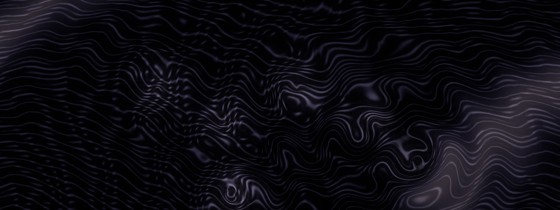
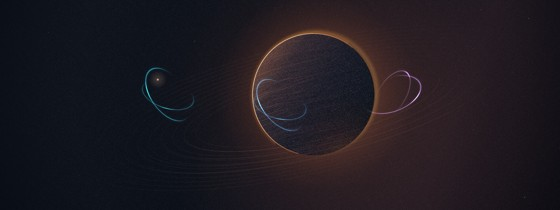

# Action75 壁纸仓库

在这里预览 Action75 键盘副屏的互动壁纸，选择喜欢的作品，下载对应压缩包即可单独导入。本目录提供 DirectX 12 版本，建议使用 Action75 Wallpaper 0.4.1 或更高版本。

**[下载播放器](https://github.com/blackwhite-poi/Action75-Wallpaper/releases/latest)** · [制作壁纸](https://github.com/blackwhite-poi/Action75-Wallpaper#制作并接入自己的壁纸) · [机器可读目录](catalog.json)

## 导入方法

选择下方的壁纸并下载 ZIP，在控制台点击 **壁纸库 → 导入 → ZIP 压缩包**，直接选择下载的文件。也可以选择「壁纸文件夹」导入已解压的作品。若已有同一款壁纸，请按控制台的提示确认更新。

## 壁纸目录

| 预览 | 壁纸 | 下载 |
| --- | --- | --- |
|  | **磁流体** 一滴有重量的磁液。磁极牵引前缘、尾缘回卷，远处的液体靠近键位时才长出尖峰。 | [下载 磁流体.zip](https://raw.githubusercontent.com/blackwhite-poi/Action75-Wallpaper-Library/main/packs/%E7%A3%81%E6%B5%81%E4%BD%93.zip) |
|  | **余像** 玻璃切面的紫色薄暮；短促的棱镜闪光沿放射方向散开。 | [下载 余像.zip](https://raw.githubusercontent.com/blackwhite-poi/Action75-Wallpaper-Library/main/packs/%E4%BD%99%E5%83%8F.zip) |
|  | **黑洞** 引力透镜弯折星云、虚空或星空，按键点亮带星芒的恒星。黑洞可拖动、缩放，阴影覆盖的键位保持静默。 | [下载 黑洞.zip](https://raw.githubusercontent.com/blackwhite-poi/Action75-Wallpaper-Library/main/packs/%E9%BB%91%E6%B4%9E.zip) |
|  | **载波** 暗橄榄色底上的磷光信号束；击键发出左右传播的分段脉冲。 | [下载 载波.zip](https://raw.githubusercontent.com/blackwhite-poi/Action75-Wallpaper-Library/main/packs/%E8%BD%BD%E6%B3%A2.zip) |
|  | **朱砂拓印** 有纸纹的暖色留白与赭红浮雕；按键在纸面晕染出矿物颜料。 | [下载 朱砂拓印.zip](https://raw.githubusercontent.com/blackwhite-poi/Action75-Wallpaper-Library/main/packs/%E6%9C%B1%E7%A0%82%E6%8B%93%E5%8D%B0.zip) |
|  | **鎏金脉络**  | [下载 鎏金脉络.zip](https://raw.githubusercontent.com/blackwhite-poi/Action75-Wallpaper-Library/main/packs/%E9%8E%8F%E9%87%91%E8%84%89%E7%BB%9C.zip) |
|  | **碎光玻璃** 按键处绽开玻璃裂纹，折射出飞散的碎片。每次按下的力度在设定范围内随机变化，可切换极夜蓝、琥珀暮光和银雾背景。 | [下载 碎光玻璃.zip](https://raw.githubusercontent.com/blackwhite-poi/Action75-Wallpaper-Library/main/packs/%E7%A2%8E%E5%85%89%E7%8E%BB%E7%92%83.zip) |
|  | **声纹织物**  | [下载 声纹织物.zip](https://raw.githubusercontent.com/blackwhite-poi/Action75-Wallpaper-Library/main/packs/%E5%A3%B0%E7%BA%B9%E7%BB%87%E7%89%A9.zip) |
|  | **键影**  | [下载 键影.zip](https://raw.githubusercontent.com/blackwhite-poi/Action75-Wallpaper-Library/main/packs/%E9%94%AE%E5%BD%B1.zip) |
|  | **日蚀经线** 连续时间解析轨道弧：平滑生长、沿弧流光和自然淡出。保留原背景及配色。 | [下载 日蚀经线.zip](https://raw.githubusercontent.com/blackwhite-poi/Action75-Wallpaper-Library/main/packs/%E6%97%A5%E8%9A%80%E7%BB%8F%E7%BA%BF.zip) |
|  | **烟火** 按键或点按副屏，烟花从触点原地绽放。心形沿轮廓扩张，蓝银棕榈向上展开长枝。十种花型可自由组合，每发可抽取一套配色。 | [下载 烟火.zip](https://raw.githubusercontent.com/blackwhite-poi/Action75-Wallpaper-Library/main/packs/%E7%83%9F%E7%81%AB.zip) |
|  | **水彩喷溅** 使用原作贴图与解码运动曲线的原生复现；九组配色、喷溅、水滴与淡出。当前为移植试用版，色彩显示管线仍待原版对照。 | [下载 水彩喷溅.zip](https://raw.githubusercontent.com/blackwhite-poi/Action75-Wallpaper-Library/main/packs/%E6%B0%B4%E5%BD%A9%E5%96%B7%E6%BA%85.zip) |
|  | **潮汐绢墨**  | [下载 潮汐绢墨.zip](https://raw.githubusercontent.com/blackwhite-poi/Action75-Wallpaper-Library/main/packs/%E6%BD%AE%E6%B1%90%E7%BB%A2%E5%A2%A8.zip) |
|  | **水波** 点击副屏或按下 Action75 键位，力度各异的涟漪从触点扩散、交叠。背景可换成月下深池、海盐浅湾、暮霞、黑曜石或自定义底色。 | [下载 水波.zip](https://raw.githubusercontent.com/blackwhite-poi/Action75-Wallpaper-Library/main/packs/%E6%B0%B4%E6%B3%A2.zip) |
|  | **潮汐玻璃** 冷青色切面的深海玻璃；按键泛起折射边缘与一圈短促波纹。 | [下载 潮汐玻璃.zip](https://raw.githubusercontent.com/blackwhite-poi/Action75-Wallpaper-Library/main/packs/%E6%BD%AE%E6%B1%90%E7%8E%BB%E7%92%83.zip) |
