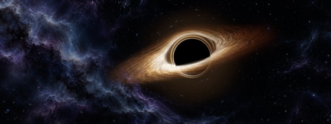
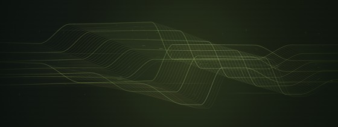
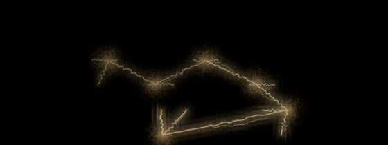
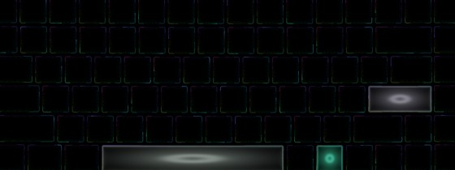
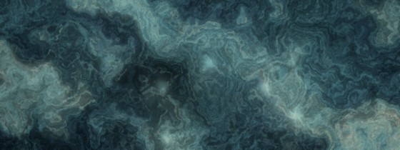

# Action75 壁纸仓库

这里收录了 Action75 Wallpaper 的 15 款互动壁纸。每款都有独立下载包，可以单独安装。以下壁纸已在 Windows x64 版 0.3.8 上试播。

**[下载播放器](https://github.com/blackwhite-poi/Action75-Wallpaper/releases/latest)** · [制作壁纸](https://github.com/blackwhite-poi/Action75-Wallpaper#制作并接入自己的壁纸) · [机器可读目录](catalog.json)

## 导入方法

选择下方的壁纸并下载 ZIP，解压后在控制台点击 **壁纸库 → 导入壁纸**，选择直接包含 `manifest.json` 的文件夹。若已有同一款壁纸，请按控制台的提示确认更新。

## 壁纸目录

| 预览 | 壁纸 | 下载 |
| --- | --- | --- |
|  | **磁流体** 一滴有重量的磁液。磁极牵引前缘、尾缘回卷，远处的液体靠近键位时才长出尖峰。 | [下载 ZIP](https://raw.githubusercontent.com/blackwhite-poi/Action75-Wallpaper-Library/main/packs/meniscus-ferrofluid-v1.zip) |
|  | **余像** 玻璃切面的紫色薄暮；短促的棱镜闪光沿放射方向散开。 | [下载 ZIP](https://raw.githubusercontent.com/blackwhite-poi/Action75-Wallpaper-Library/main/packs/afterimage.zip) |
|  | **黑洞** 引力透镜弯折星云、虚空或星空，按键点亮带星芒的恒星。黑洞可拖动、缩放，阴影覆盖的键位保持静默。 | [下载 ZIP](https://raw.githubusercontent.com/blackwhite-poi/Action75-Wallpaper-Library/main/packs/black-hole.zip) |
|  | **载波** 暗橄榄色底上的磷光信号束；击键发出左右传播的分段脉冲。 | [下载 ZIP](https://raw.githubusercontent.com/blackwhite-poi/Action75-Wallpaper-Library/main/packs/carrier.zip) |
|  | **朱砂拓印** 有纸纹的暖色留白与赭红浮雕；按键在纸面晕染出矿物颜料。 | [下载 ZIP](https://raw.githubusercontent.com/blackwhite-poi/Action75-Wallpaper-Library/main/packs/folio.zip) |
|  | **鎏金脉络**  | [下载 ZIP](https://raw.githubusercontent.com/blackwhite-poi/Action75-Wallpaper-Library/main/packs/gilded-synapse.zip) |
|  | **碎光玻璃** 按键处绽开玻璃裂纹，折射出飞散的碎片。每次按下的力度在设定范围内随机变化，可切换极夜蓝、琥珀暮光和银雾背景。 | [下载 ZIP](https://raw.githubusercontent.com/blackwhite-poi/Action75-Wallpaper-Library/main/packs/glass-shatter.zip) |
|  | **声纹织物**  | [下载 ZIP](https://raw.githubusercontent.com/blackwhite-poi/Action75-Wallpaper-Library/main/packs/harmonic-textile.zip) |
|  | **键影**  | [下载 ZIP](https://raw.githubusercontent.com/blackwhite-poi/Action75-Wallpaper-Library/main/packs/keycap-glow.zip) |
|  | **日蚀经线** 连续时间解析轨道弧：平滑生长、沿弧流光和自然淡出。保留原背景及配色。 | [下载 ZIP](https://raw.githubusercontent.com/blackwhite-poi/Action75-Wallpaper-Library/main/packs/meridian.zip) |
|  | **烟火** 按键或点按副屏，烟花从触点原地绽放。心形沿轮廓扩张，蓝银棕榈向上展开长枝。十种花型可自由组合，每发可抽取一套配色。 | [下载 ZIP](https://raw.githubusercontent.com/blackwhite-poi/Action75-Wallpaper-Library/main/packs/night-fireworks.zip) |
|  | **水彩喷溅** 使用原作贴图与解码运动曲线的原生复现；九组配色、喷溅、水滴与淡出。当前为移植试用版，色彩显示管线仍待原版对照。 | [下载 ZIP](https://raw.githubusercontent.com/blackwhite-poi/Action75-Wallpaper-Library/main/packs/paintball-native.zip) |
|  | **潮汐绢墨**  | [下载 ZIP](https://raw.githubusercontent.com/blackwhite-poi/Action75-Wallpaper-Library/main/packs/silk-nebula.zip) |
|  | **水波** 点击副屏或按下 Action75 键位，力度各异的涟漪从触点扩散、交叠。背景可换成月下深池、海盐浅湾、暮霞、黑曜石或自定义底色。 | [下载 ZIP](https://raw.githubusercontent.com/blackwhite-poi/Action75-Wallpaper-Library/main/packs/stillwater.zip) |
|  | **潮汐玻璃** 冷青色切面的深海玻璃；按键泛起折射边缘与一圈短促波纹。 | [下载 ZIP](https://raw.githubusercontent.com/blackwhite-poi/Action75-Wallpaper-Library/main/packs/tidal-glass.zip) |
